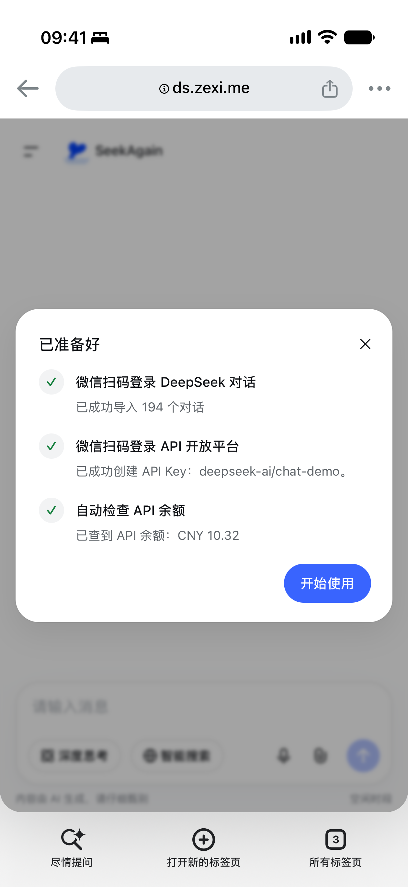

#  SeekAgain

**🐳 DeepSeek 官网死掉的对话，SeekAgain 接着聊！**

[在线使用 ds.zexi.me](https://ds.zexi.me/)



**自动创建 API Key，一键余额充值。SeekAgain 服务端不留存用户数据。**

## 特性

- **导入旧对话**。微信扫码从 DeepSeek 官网导入，也可以手动导入 ZIP。重新导入会补进新增消息。
- **管理 DeepSeek API**。可手动填写已有的 Key，随时查询余额，充值款项进入你的 DeepSeek 开放平台账户。
- **从任意一轮接着聊**。编辑提问、重新生成、切换对话分支，保留各个版本。
- **安装到手机或电脑**。支持 PWA、浅色和深色主题，以及语音输入、朗读、附件和联网搜索。
- **聊天记录保存在浏览器**。对话和附件保存在本机，聊天请求直接发给 DeepSeek。SeekAgain 服务端仅在请求期间中继授权、导入、创建 Key 和充值。
- **前后端完整开源**。可以使用公开实例，也可以在自己的服务器运行。

## 自行部署

```sh
docker run -d --name seek-again --restart unless-stopped \
  -p 127.0.0.1:8090:8090 ghcr.io/wangzexi/seek-again:latest
```

打开 [127.0.0.1:8090](http://127.0.0.1:8090/)。通过 HTTPS 反向代理部署时，给容器设置 `APP_ORIGIN`（如 `https://ds.zexi.me`），并保留原始 `Host` 请求头，将网页和 `/api/` 转发到同一个容器。

从源码构建可用仓库里的 [Dockerfile](Dockerfile)。本地开发使用 Bun 和 Cargo，在仓库根目录运行 `bun install && bun run build && bun run start`。浏览器端在 `web/`，Rust 中继在 `server/`。

基于 [DeepSeek Chat Demo](https://github.com/deepseek-ai/chat-demo)，采用 [MIT 许可证](LICENSE)。
